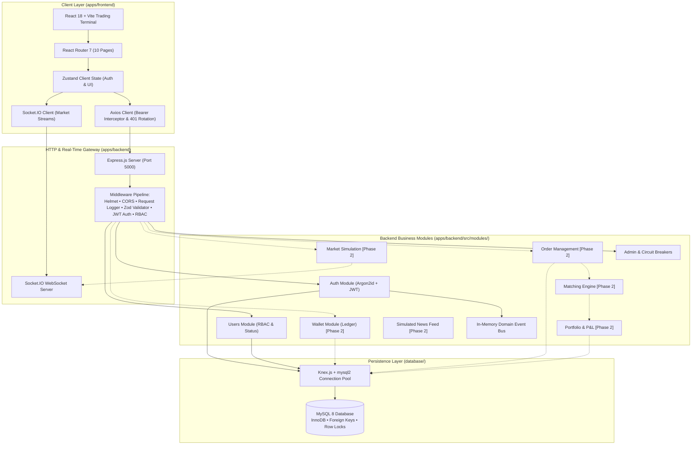

# TRADEGRID – System Architecture

* **Status:** Phase 1 Foundation Implemented (Clean Monorepo Modular Monolith)
* **Backend:** Node.js + Express.js + TypeScript
* **Frontend:** React + TypeScript + Vite + Tailwind CSS
* **Database:** MySQL 8 (ACID Relational System of Record)

TRADEGRID is an **educational virtual stock exchange**. It does not move real money, connect to external brokerages, or execute real trades. The backend is the **sole source of truth** for prices used in settlement, orders, executions, cash, and portfolios. Charts and UIs display that truth; they never invent or modify balances.

---

## 1. Architectural Style: Modular Monolith

TRADEGRID utilizes a **Modular Monolith** architecture:
* A single Node.js Express process owns all business modules in `apps/backend/src/modules/`.
* One MySQL 8 database acts as the durable system of record.
* Frontend trading terminal and admin operations communicate with the backend via REST endpoints and Socket.IO WebSocket streams.

### Why Modular Monolith fits TRADEGRID:
1. **Low Operational Overhead:** Running one API service and one database locally is radically simpler than managing 10+ microservices for a student project.
2. **Strict Module Boundaries:** Clean code organization (`controller` -> `service` -> `repository`) ensures modules do not tightly couple.
3. **Future Microservice Extraction Path:** If a component (such as the Order Matching Engine or Market Simulation) later requires dedicated compute, it can be extracted into an independent microservice (e.g. in Go or Python) with zero architectural rework.



---

## 2. Layered Architecture within Modules

Each business module adheres strictly to three-tier separation of concerns:

```text
HTTP Request
     │
     ▼
┌──────────────┐
│  Controller  │  Thin layer: Extracts request params, invokes service, formats HTTP response
└──────┬───────┘
       │
       ▼
┌──────────────┐
│   Service    │  Business logic: Domain rules, validation, Argon2id hashing, token generation
└──────┬───────┘
       │
       ▼
┌──────────────┐
│  Repository  │  Data access: SQL queries via Knex, database transactions, isolation locks
└──────┬───────┘
       │
       ▼
  MySQL 8 DB
```

* **Controllers never talk to the database directly.**
* **Services never read `req` or `res` directly.**
* **Repositories only handle data querying and persistence.**

---

## 3. Module Inventory & Responsibilities

| # | Module | Phase | Responsibility | Boundaries & Exclusions |
|---|---|---|---|---|
| 1 | **Auth** | **Phase 1** | User registration, login, Argon2id hashing, JWT access token issue, refresh token rotation, logout | Does not own wallet cash or trading positions |
| 2 | **Users** | **Phase 1** | Profile querying, role assignment (`TRADER`, `ADMIN`), account suspension | Does not handle financial balances |
| 3 | **Admin** | **Phase 1** | Global circuit breaker (Emergency Halt / Resume), user status management, simulated shock triggers | Does not execute trades directly |
| 4 | **Wallet** | Phase 2 | Double-entry virtual cash ledger, deposit grants, balance reservation for open buy orders | Does not match orders |
| 5 | **Market Simulation** | Phase 2 | Synthetic price path generation, sentiment drift, random walk with mean reversion | Does not modify trader cash balances |
| 6 | **Trading (OMS)** | Phase 2 | Accepts limit/market orders, checks cash/share buying power, maintains order lifecycle | Does not pair buy and sell orders |
| 7 | **Matching Engine** | Phase 2 | In-memory Price-Time Priority limit order book per symbol, trade matching, execution prints | Does not invent prices or fake fills |
| 8 | **Portfolio** | Phase 2 | Tracks stock positions, average cost basis, realized and unrealized P&L | Does not render UI charts |
| 9 | **News Feed** | Phase 2 | Synthetic catalyst generation, simulated news wire with explicit disclaimer tags | Does not connect to real financial news |
| 10 | **Competitions** | Phase 3 | Timed trading tournaments, starting cash snapshot, live leaderboard rankings | Does not alter exchange rules |
| 11 | **Global Chat** | Phase 3 | Moderated student discussion channels and symbol chat rooms | Public; never exposes private positions |

---

## 4. End-to-End Data Paths

### A. Authentication & Refresh Path (Implemented in Phase 1)
1. Trader UI submits `POST /api/v1/auth/login` with email and password.
2. Zod middleware validates request payload shape.
3. `AuthController` passes credentials to `AuthService`.
4. `AuthService` queries `UserRepository` for the user record.
5. `verifyPassword(hash, plain)` checks the Argon2id hash.
6. `AuthService` generates a short-lived Access Token (15m TTL) and a Refresh Token (7d TTL).
7. The Refresh Token is hashed via SHA-256 and stored in `user_sessions`.
8. The client receives `{ user, tokens }` (passwords and hashes are **never** returned).
9. On token expiration, Axios interceptor calls `POST /api/v1/auth/refresh`, the old session is revoked, and a rotated token pair is returned.

### B. Order Placement & Matching Path (Phase 2 Blueprint)
1. Trader UI submits `POST /api/v1/orders`.
2. Auth middleware verifies JWT token and extracts user ID.
3. Exchange guard verifies global session is `OPEN` (not `HALTED`).
4. Risk check locks user's cash (for BUY) or shares (for SELL) in MySQL within a transaction.
5. Order Management inserts order record (`STATUS = ACCEPTED`).
6. Matching Engine processes the order against the symbol's in-memory book using **Price-Time Priority**.
7. If a match occurs:
   - One atomic DB transaction writes trade prints to `trades`, debits/credits the `cash_ledger`, and updates `positions`.
8. WebSocket event broadcasts the trade print to public ticker rooms and private fill alerts to the participating users.

---

## 5. Financial Accuracy & Source of Truth Rules

| Domain Data | Authority | Safety Mechanism |
|---|---|---|
| **Cash Balances** | MySQL 8 `cash_ledger` | Append-only double-entry ledger. Stored as `DECIMAL(19,4)`. Floating point math is strictly forbidden. |
| **Share Holdings** | MySQL 8 `positions` | Row-level locking during order submission (`SELECT ... FOR UPDATE`). |
| **Working Orders** | MySQL 8 `orders` | Durable system of record. In-memory order books are rebuilt from active database rows on startup. |
| **Display Charts** | Server OHLCV aggregation | UIs and charts only render server-derived bars; they never synthesize prices. |
| **Client State** | Zustand (Ephemeral) | UI cache only. On browser refresh or reconnect, user state is refetched from `/api/v1/auth/me` and `/portfolio`. |

---

## 6. Concurrency & Scaling (Target: 100+ Concurrent Users)

* **Asynchronous Event Loop:** Node.js handles I/O-bound requests concurrently using libuv non-blocking worker threads.
* **MySQL Connection Pool:** Configured via `mysql2` with pool sizing (`DB_CONNECTION_LIMIT=10`), preventing database socket starvation.
* **Single-Threaded Matcher Isolation:** Order matching per symbol runs in a deterministic queue, preventing race conditions where two trades could double-spend the same cash allocation.
