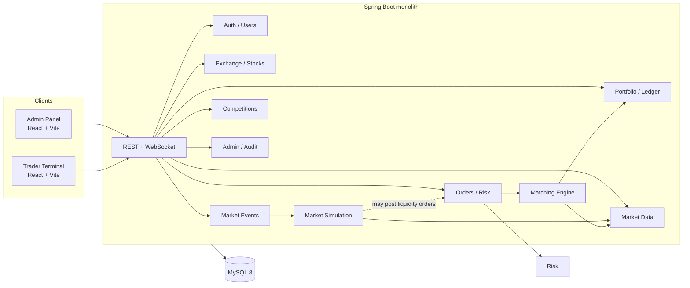
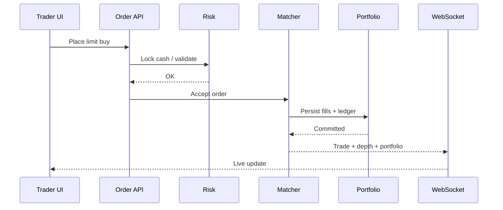

# TRADEGRID – System Architecture

**Status:** Phase 1 blueprint (not implemented).  
**Verified in repository:** documentation only; no application source, APIs, or database.

TRADEGRID is an **educational virtual stock exchange**. It does not move real money, connect to brokerages, or settle real trades. The backend is the **only source of truth** for prices used in settlement, orders, executions, cash, and portfolios. Charts and UIs display that truth; they never invent balances.

## 1. Architectural style

**Modular monolith.**

One Spring Boot process owns all modules. One MySQL database is the system of record. Two frontend apps (admin panel and trader terminal) talk to the same backend over REST and WebSockets.

Why this fits a college project:

- Easier to run locally (one API, one database) than microservices.
- Module packages still keep matching, simulation, and portfolio code from mixing.
- You can extract a service later if needed; you do not start with distributed complexity.



Simulation and matching are **separate modules**. Simulation proposes a fair value and optional liquidity. Matching only pairs real (and optional synthetic) orders using the order book.

## 2. Target technology stack

No conflicting stack exists in the repository, so the following is the **intended** stack for implementation (after you approve Phase 1):

| Layer | Technology | Role |
|-------|------------|------|
| Frontend | React + TypeScript + Vite | Admin and trader UIs |
| Styling | Tailwind CSS | Layout and theming |
| Charts | TradingView Lightweight Charts | Candles / line charts (display only) |
| Client state | Zustand | UI state; not balances or fills |
| Backend | Java 17 + Spring Boot | Modular monolith |
| Security | Spring Security | AuthN / AuthZ |
| Persistence | JDBC / JdbcTemplate + Flyway | SQL you can read and review |
| Real-time | Spring WebSocket (STOMP or raw) | Quotes, depth, fills |
| Database | MySQL 8 | System of record |
| Build | Maven | Backend |
| Runtime (dev) | Docker Compose | MySQL (and later the API) |

Details: [TECH_STACK.md](TECH_STACK.md), [DATABASE_DESIGN.md](DATABASE_DESIGN.md).

## 3. Proposed source layout (future)

Not present on disk yet. Intended after approval:

```text
TRADEGRID/
├── backend/                 # Maven, Spring Boot
│   └── src/main/java/com/tradegrid/
│       ├── auth/
│       ├── user/
│       ├── exchange/
│       ├── stock/
│       ├── market/          # simulation engine
│       ├── order/
│       ├── matching/        # order book + matcher
│       ├── portfolio/
│       ├── event/
│       ├── marketdata/
│       ├── risk/
│       ├── analytics/
│       ├── competition/
│       ├── admin/
│       └── common/
├── frontend/
│   ├── trader/              # Vite app
│   └── admin/               # Vite app
├── docker-compose.yml
└── docs/
```

Two frontend apps keep admin tools off the trader screen and make role mistakes harder.

## 4. Module responsibilities

| # | Module | Owns | Does not own |
|---|--------|------|----------------|
| 1 | Authentication and Authorization | Login, tokens/sessions, roles, password hashing | User profile fields beyond identity |
| 2 | User Management | Registration, profile, status (active/suspended) | Cash ledger |
| 3 | Exchange Management | Sessions: pre-open, open, halt, close; tick/lot rules | Matching algorithm |
| 4 | Stock Management | Listings, sector, status, tick size, lot size | Live last price (market data) |
| 5 | Market Simulation Engine | Fair-value path, sentiment, volatility, synthetic liquidity policy | Crossing two trader orders |
| 6 | Order Management | Accept/reject/cancel/amend API, order lifecycle persistence | Continuous matching loop |
| 7 | Order Matching Engine | In-memory book per symbol, price-time priority, trades | Setting “news” or crash events |
| 8 | Portfolio Management | Positions, cash ledger, realized/unrealized P&amp;L from trades | Chart rendering |
| 9 | Market Event Engine | Admin events (crash, rally, news), scheduled impact curves | Directly debiting accounts |
| 10 | Market Data and Price History | Last, bid/ask, trades, OHLCV bars | Order validation |
| 11 | Risk Management | Buying power, short rules (if any), max order size, halt checks | UI watchlists |
| 12 | Trading Analytics | Aggregates: volume, VWAP, participant stats | Source-of-truth balances |
| 13 | Competition Management | Contests, start/end, starting cash snapshot, ranking | Matching |
| 14 | Administration and Audit Logs | Admin actions, immutable audit rows | Trading math |

## 5. How modules communicate

All communication is **in-process** (method calls / Spring events). No extra message broker in Phase 1.

Typical order path (student-friendly):

1. Trader UI sends `POST /api/orders`.
2. **Auth** identifies the user.
3. **Exchange** confirms the session is open for that symbol.
4. **Risk** checks cash or share availability (with a database lock; see [MATCHING_ENGINE.md](MATCHING_ENGINE.md)).
5. **Order Management** inserts the order (`NEW` / `ACCEPTED`).
6. **Matching Engine** tries to match on that symbol’s book (single-threaded per symbol).
7. Each fill writes **trades**, updates **portfolio** (cash + position) in one database transaction.
8. **Market Data** records last price and publishes WebSocket updates.
9. **Audit** records admin actions separately; user orders are already in `orders` / `trades`.

Simulation path (separate):

1. A scheduler tick runs **Market Simulation**.
2. Simulation updates fair value from baseline + sentiment + inventory/order-flow + events.
3. Optionally it submits **synthetic liquidity orders** through Order Management (tagged `source = SIMULATION`) so the book has depth.
4. It never overwrites trader balances.



## 6. Source of truth rules

| Data | Authority |
|------|-----------|
| Cash and positions | MySQL via Portfolio module |
| Open orders and trades | MySQL; in-memory book is a cache rebuilt on startup |
| Display charts | Market data tables / streams derived from trades and simulation ticks |
| Zustand store | Ephemeral UI only; refetch after reconnect |

On restart, reload working orders from MySQL and rebuild books. Do not treat RAM as durable.

## 7. Consistency and money

- Persist money and prices as `DECIMAL` (see [DATABASE_DESIGN.md](DATABASE_DESIGN.md)).
- Use `BigDecimal` in Java with a fixed scale and `RoundingMode.HALF_UP` (document the scale per field).
- Never use `double` / `float` for cash, prices, fees, or P&amp;L.
- Matching and settlement for one symbol run on **one thread** so two fills cannot debit the same cash twice without a queue.

## 8. User interfaces (structure only)

Do **not** implement the full UI in Phase 1. Two Vite apps share design tokens but not routes.

### A. Exchange administration panel

Proposed screens:

| Screen | Job |
|--------|-----|
| Login | Admin auth |
| Session control | Start, halt, resume, close the exchange |
| Listings | CRUD stocks, opening/baseline price, tick, lot, per-name halt |
| Simulation | Volatility, liquidity depth, seed (read/adjust) |
| Events | Inject crash/rally/news/sector shock; schedule window |
| Order blotter | All working orders, force-cancel if you later approve that power |
| Trade tape | Executed trades |
| Participants | Activity, suspend user, virtual cash grant |
| Analytics | Volume, concentration, halt history |
| Audit | Filter `audit_logs` |

Admins should not trade on this app in v1 (reduces accidental self-dealing in contests). **Decision if admins may also have a trader login.**

### B. Trader terminal

Proposed screens:

| Screen | Job |
|--------|-----|
| Login / register | Auth |
| Market watch | Live prices, watchlist |
| Symbol desk | Chart (Lightweight Charts), depth, place/cancel orders |
| Portfolio | Cash, reserved, holdings, realized and unrealized P&amp;L |
| Orders & history | Status, fills |
| News / events | Visible market events |
| Competition | Join, rank (when built) |
| Account | Display name only; no “edit my cash” |

Zustand holds UI tabs, chart interval, and **cached** quotes. On reconnect, reload portfolio and orders from the API.

## 9. Related documents

- [MARKET_ENGINE.md](MARKET_ENGINE.md)
- [MATCHING_ENGINE.md](MATCHING_ENGINE.md)
- [DATABASE_DESIGN.md](DATABASE_DESIGN.md)
- [API_DESIGN.md](API_DESIGN.md)
- [SECURITY.md](SECURITY.md)
- [TESTING_STRATEGY.md](TESTING_STRATEGY.md)
- [DEVELOPMENT_ROADMAP.md](DEVELOPMENT_ROADMAP.md)
