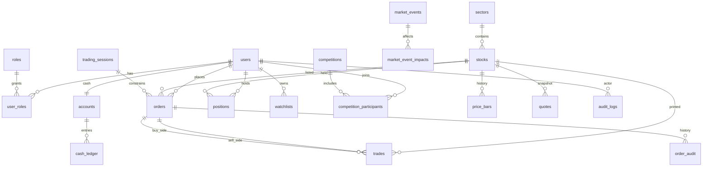

# TRADEGRID – Database Design (Proposed)

**Status:** Proposed schema for Phase 1. **Not created in MySQL. No Flyway scripts exist yet.**

Existing check: [DATABASE_DOCUMENTATION.md](DATABASE_DOCUMENTATION.md) — the repository still has **no** `.sql` files. This design does not duplicate live tables; it is the first schema proposal.

Educational simulator only. No real-money accounts.

## 1. Design rules

| Rule | Why |
|------|-----|
| `DECIMAL` for money, prices, quantities, fees | Binary floating point (`FLOAT`/`DOUBLE`) cannot represent 0.1 exactly |
| InnoDB + explicit transactions | Atomic fill: trade + cash + position together |
| Soft states on orders (`NEW`, `PARTIAL`, `FILLED`, …) | History stays queryable |
| Ledger rows are insert-only | You can rebuild cash from the ledger if a cache column drifts |
| UUID or BIGINT PKs | BIGINT auto-increment is enough and simpler for a student project |
| No secrets in SQL | Passwords stored hashed; connection strings stay in env vars |

**Proposed numeric types**

| Use | Type | Example scale |
|-----|------|----------------|
| Cash, fees, P&amp;L | `DECIMAL(19,4)` | 100000.0000 virtual INR/USD |
| Price | `DECIMAL(18,4)` | 1523.2500 |
| Quantity | `DECIMAL(18,4)` | Allow fractional shares for teaching; lot size can still be 1 |
| Ratios / volatility | `DECIMAL(12,8)` | Internal simulation only |

**Decision needed:** currency code (e.g. `INR`) and starting cash (e.g. `100000.0000`).

## 2. Entity-relationship (logical)

## 3. Table inventory

Core identity

| Table | Purpose |
|-------|---------|
| `users` | Login identity, status, display name |
| `roles` | `TRADER`, `ADMIN` (optional `MODERATOR`) |
| `user_roles` | Many-to-many |
| `accounts` | One cash account per user (virtual) |
| `cash_ledger` | Append-only money movements |

Listings and sessions

| Table | Purpose |
|-------|---------|
| `sectors` | Sector grouping for events |
| `stocks` | Symbol, name, tick, lot, status |
| `trading_sessions` | Open/halt/close windows |
| `exchange_settings` | Fees, halt bands, simulation seed |

Orders and executions

| Table | Purpose |
|-------|---------|
| `orders` | Working and historical orders |
| `trades` | Each execution (one row per fill) |
| `order_audit` | Status changes / cancels |

Portfolio and market data

| Table | Purpose |
|-------|---------|
| `positions` | Shares per user per stock |
| `quotes` | Latest bid/ask/last (cache; rebuildable) |
| `price_bars` | OHLCV for charts |
| `price_ticks` | Optional high-resolution ticks |

Simulation, risk, social features

| Table | Purpose |
|-------|---------|
| `market_events` | Admin-injected or scheduled events |
| `market_event_impacts` | Per-stock or per-sector multipliers / curves |
| `risk_limits` | Per-user or global caps |
| `watchlists` / `watchlist_items` | Trader UI |
| `competitions` / `competition_participants` | Contests |
| `audit_logs` | Admin and security actions |
| `idempotency_keys` | Prevent duplicate order submits |

## 4. Column sketch (authoritative fields)

### `users`

| Column | Type | Notes |
|--------|------|--------|
| `id` | BIGINT PK | |
| `email` | VARCHAR(255) UNIQUE NOT NULL | Login |
| `password_hash` | VARCHAR(255) NOT NULL | BCrypt; never plaintext |
| `display_name` | VARCHAR(80) | |
| `status` | ENUM/VARCHAR | `ACTIVE`, `SUSPENDED` |
| `created_at` | TIMESTAMP | |

### `accounts`

| Column | Type | Notes |
|--------|------|--------|
| `id` | BIGINT PK | |
| `user_id` | BIGINT UNIQUE FK | One account v1 |
| `currency` | CHAR(3) | e.g. `INR` |
| `cash_available` | DECIMAL(19,4) | Free cash |
| `cash_reserved` | DECIMAL(19,4) | Locked for open buys |
| `version` | BIGINT | Optimistic lock |

Invariant: `cash_available >= 0`, `cash_reserved >= 0`. Enforce in application **and** `CHECK` if MySQL version allows.

### `cash_ledger`

| Column | Type | Notes |
|--------|------|--------|
| `id` | BIGINT PK | |
| `account_id` | BIGINT FK | |
| `amount` | DECIMAL(19,4) | Signed; debit negative |
| `balance_after` | DECIMAL(19,4) | |
| `type` | VARCHAR | `RESERVE`, `RELEASE`, `TRADE`, `FEE`, `GRANT` |
| `ref_type` / `ref_id` | | Order or trade id |
| `created_at` | TIMESTAMP | |

### `stocks`

| Column | Type | Notes |
|--------|------|--------|
| `id` | BIGINT PK | |
| `symbol` | VARCHAR(16) UNIQUE | `TGRID` |
| `name` | VARCHAR(120) | |
| `sector_id` | BIGINT FK | |
| `tick_size` | DECIMAL(18,4) | |
| `lot_size` | DECIMAL(18,4) | |
| `status` | VARCHAR | `ACTIVE`, `HALTED`, `DELISTED` |
| `baseline_price` | DECIMAL(18,4) | Simulation anchor |
| `volatility` | DECIMAL(12,8) | Per-name vol |

### `orders`

| Column | Type | Notes |
|--------|------|--------|
| `id` | BIGINT PK | |
| `client_order_id` | VARCHAR(64) | Idempotency with user_id |
| `user_id` | BIGINT FK | Null or system user for simulation liquidity |
| `stock_id` | BIGINT FK | |
| `side` | VARCHAR | `BUY`, `SELL` |
| `type` | VARCHAR | `MARKET`, `LIMIT`, `STOP`, `STOP_LIMIT` |
| `tif` | VARCHAR | `GTC`, `IOC`, `FOK`, `DAY` |
| `limit_price` | DECIMAL(18,4) | Null for market |
| `stop_price` | DECIMAL(18,4) | Stop types |
| `quantity` | DECIMAL(18,4) | Original |
| `filled_quantity` | DECIMAL(18,4) | |
| `reserved_cash` | DECIMAL(19,4) | Buys |
| `reserved_qty` | DECIMAL(18,4) | Sells |
| `fee_rate_bps` | DECIMAL(10,4) | Snapshot at accept |
| `status` | VARCHAR | See lifecycle |
| `source` | VARCHAR | `TRADER`, `SIMULATION` |
| `session_id` | BIGINT FK | |
| `created_at` / `updated_at` | TIMESTAMP | |

Unique `(user_id, client_order_id)` where `client_order_id` is not null.

### `trades`

| Column | Type | Notes |
|--------|------|--------|
| `id` | BIGINT PK | |
| `stock_id` | BIGINT FK | |
| `buy_order_id` | BIGINT FK | |
| `sell_order_id` | BIGINT FK | |
| `price` | DECIMAL(18,4) | Execution price |
| `quantity` | DECIMAL(18,4) | |
| `buy_fee` / `sell_fee` | DECIMAL(19,4) | |
| `executed_at` | TIMESTAMP(3) | |

### `positions`

| Column | Type | Notes |
|--------|------|--------|
| `id` | BIGINT PK | |
| `user_id` + `stock_id` | UNIQUE | |
| `quantity` | DECIMAL(18,4) | Long only in v1 unless shorts approved |
| `qty_reserved` | DECIMAL(18,4) | Open sells |
| `avg_cost` | DECIMAL(18,4) | For unrealized P&amp;L |
| `version` | BIGINT | Optimistic lock |

### Other tables (short)

- `trading_sessions`: `status` (`PREOPEN`,`OPEN`,`HALT`,`CLOSED`), `opened_at`, `closed_at`.
- `quotes`: `bid`, `bid_size`, `ask`, `ask_size`, `last`, `last_size`, `updated_at`.
- `price_bars`: `timeframe` (`1m`,`5m`,`1d`), `open,high,low,close,volume`, unique `(stock_id,timeframe,bar_start)`.
- `market_events`: `type` (`CRASH`,`RALLY`,`NEWS`,`SECTOR_SHOCK`,`LIQUIDITY_DRY`), `severity`, `starts_at`, `ends_at`, `seed_offset`.
- `market_event_impacts`: `target_type` (`STOCK`/`SECTOR`/`MARKET`), `drift_delta`, `vol_multiplier`, `decay_seconds`.
- `risk_limits`: `max_order_notional`, `max_position_qty`, `allow_short` (default false).
- `audit_logs`: `actor_user_id`, `action`, `entity`, `payload_json`, `ip`, `created_at`.
- `idempotency_keys`: `user_id`, `key`, `request_hash`, `response_json`, `created_at`.
- `competitions`: name, start/end, starting cash, fee schedule snapshot.

## 5. Keys and indexes

| Table | Indexes |
|-------|---------|
| `orders` | `(stock_id, status, side, limit_price, created_at)` for recovery; `(user_id, created_at)` |
| `trades` | `(stock_id, executed_at)`, `(buy_order_id)`, `(sell_order_id)` |
| `cash_ledger` | `(account_id, created_at)` |
| `price_bars` | unique `(stock_id, timeframe, bar_start)` |
| `audit_logs` | `(created_at)`, `(actor_user_id)` |
| `quotes` | PK `stock_id` |

Foreign keys: all `user_id`, `stock_id`, `order_id` references with `ON DELETE RESTRICT` so history is not silently dropped.

## 6. Transactions

Settlement unit = **one fill** (or a batch of fills for one incoming order) in a **single DB transaction**:

1. `SELECT … FOR UPDATE` account and position rows.
2. Insert `trades`.
3. Update order filled qty/status.
4. Insert `cash_ledger`; update `accounts`.
5. Update `positions` and `avg_cost`.
6. Update `quotes` / last.
7. Commit.

Isolation: **READ COMMITTED** plus row locks is enough if matching is single-threaded per symbol. Still lock account/position rows so a user trading **two symbols at once** cannot double-spend cash.

## 7. History and audit

| Data | Retention idea |
|------|----------------|
| Orders, trades, ledger | Keep for the life of the course project |
| Price ticks | Optional; downsample to bars |
| Audit logs | Append-only; no updates |
| Simulation seed | Stored in `exchange_settings` so tests replay |

## 8. What will not be in v1 schema

- Real KYC / bank tables
- Multi-currency wallets
- Brokerage sub-accounts
- Duplicate “wallet” tables besides `accounts` + `cash_ledger`

Flyway location (future): `backend/src/main/resources/db/migration/V1__init.sql` — **not written in this phase**.

When scripts are added, copy the live column list back into [DATABASE_DOCUMENTATION.md](DATABASE_DOCUMENTATION.md) from the files, not from this proposal if they diverge.
