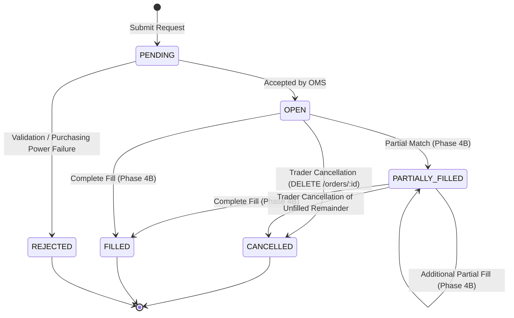

# TRADEGRID – Database Design & Double-Entry Ledger Schema

**Status:** Live & Implemented (Phases 1, 2, 3 & 4A).  
**Database Engine:** MySQL 8 with InnoDB engine.  
**Migration Tool:** Knex.js migrations (`database/migrations/`).  
**Application Scope:** Educational virtual stock exchange simulator. Virtual money only. Zero real-money banking or brokerage integrations. All fictional instruments explicitly marked SIMULATED; real instruments marked REAL with static reference pricing.

---

## 1. Accounting Principles & Financial Rules

| Principle | Technical Implementation | Architectural Rationale |
|-----------|--------------------------|-------------------------|
| **Fixed-Point Precision** | `DECIMAL(19,4)` | Binary floating point (`FLOAT`, `DOUBLE`) suffers from IEEE 754 precision inaccuracies (e.g. `0.1 + 0.2 != 0.3`). `DECIMAL(19,4)` provides 15 integral digits and 4 fractional digits, accommodating up to 999 trillion units down to 1/100th of a cent without rounding drift. |
| **Double-Entry Equality** | $\sum \text{Debits} == \sum \text{Credits}$ | Every economic movement must have balanced source and destination entries. No balance is created from thin air without an explicit counterparty equity or adjustment account. |
| **Ledger Immutability** | Insert-Only / Append-Only | Historical rows in `ledger_entries` and `ledger_transactions` are never updated or deleted. Errors are remediated via compensating transactions (e.g., administrative reversals). |
| **Materialized Balance Consistency** | `wallets.available_balance` | Stored as a row-level materialized cache for $O(1)$ fast reads, but mathematically verifiable at any time by summing the historical ledger entries for the user's ledger account. |
| **Pessimistic Row-Level Locking** | `SELECT ... FOR UPDATE` | Prevents race conditions and double-spending when concurrent requests occur (e.g., simultaneous trades or withdrawals). |
| **Idempotency Guard** | `ledger_transactions.idempotency_key` | Unique constraint guarantees that network retransmissions replay the original transaction without double-crediting or double-debiting. |

---

## 2. Double-Entry Chart of Accounts

In TRADEGRID, accounts follow standard financial asset and equity classification:

```
                      +-----------------------------+
                      |       CHART OF ACCOUNTS     |
                      +-----------------------------+
                                     |
           +-------------------------+-------------------------+
           |                                                   |
    [ ASSET ACCOUNTS ]                                 [ EQUITY ACCOUNTS ]
           |                                                   |
  +------------------+                              +-----------------------+
  |   USER_WALLET    |                              | SYSTEM_EQUITY_ISSUANCE|
  |  (User Balances) |                              |  (Virtual Cash Grants)|
  +------------------+                              +-----------------------+
           |                                                   |
           |                                        +-----------------------+
           |                                        |   SYSTEM_ADJUSTMENT   |
           |                                        |  (Clawbacks & Admin)  |
           |                                        +-----------------------+
           |                                                   |
           |                                        +-----------------------+
           |                                        |      SYSTEM_FEE       |
           |                                        |   (Transaction Fees)  |
           |                                        +-----------------------+
```

### Debit & Credit Conventions

| Account Type | Category | Increases On | Decreases On | Normal Balance |
|--------------|----------|--------------|--------------|----------------|
| `USER_WALLET` | Asset | **DEBIT** (+ Cash in user's possession) | **CREDIT** (- Cash spent or withdrawn) | Debit (Positive) |
| `SYSTEM_EQUITY_ISSUANCE` | Equity | **DEBIT** (Capital retraction) | **CREDIT** (Issuance of virtual capital grant) | Credit |
| `SYSTEM_ADJUSTMENT` | Equity / Offset | **DEBIT** (Clawback offset) | **CREDIT** (Adjustment offset) | Balanced |
| `SYSTEM_FEE` | Revenue | **DEBIT** (Fee waiver/refund) | **CREDIT** (Fee collection) | Credit |

### Example Journal Entries

#### A. Initial Signup Virtual Grant ($100,000.00 USD)
```
DEBIT   USER_WALLET (User #2)                 $100,000.0000   (Asset Increases)
CREDIT  SYSTEM_EQUITY_ISSUANCE (System)       $100,000.0000   (Equity Increases)
Total Debits: $100,000.0000 == Total Credits: $100,000.0000 (BALANCED)
```

#### B. Administrative Clawback / Debit ($5,000.00 USD)
```
DEBIT   SYSTEM_ADJUSTMENT (System)             $5,000.0000   (Offset Debit)
CREDIT  USER_WALLET (User #2)                  $5,000.0000   (Asset Decreases)
Total Debits: $5,000.0000 == Total Credits: $5,000.0000 (BALANCED)
```

---

## 3. Entity-Relationship Model (Implemented Phases 1, 2 & 3)

```mermaid
erDiagram
  users ||--o{ refresh_tokens : has
  users ||--|| wallets : owns
  users ||--o{ ledger_accounts : owns
  ledger_transactions ||--|{ ledger_entries : contains
  ledger_accounts ||--o{ ledger_entries : posts_to
  users ||--o{ ledger_transactions : creates
  users ||--o{ orders : places
  instruments ||--|| market_quotes : has_quote
  instruments ||--o{ market_candles : aggregates_candles
  instruments ||--o{ orders : traded_in

  users {
    int id PK
    string email UK
    string username UK
    string password_hash
    string role
    string status
    timestamp created_at
    timestamp updated_at
  }

  wallets {
    int id PK
    int user_id FK,UK
    string currency
    decimal available_balance "DECIMAL(19,4)"
    timestamp created_at
    timestamp updated_at
  }

  ledger_accounts {
    int id PK
    string account_type
    int owner_user_id FK,nullable
    string currency
    timestamp created_at
    timestamp updated_at
  }

  ledger_transactions {
    int id PK
    string transaction_reference UK
    string transaction_type
    string description
    string idempotency_key UK,nullable
    int created_by FK,nullable
    timestamp created_at
  }

  ledger_entries {
    int id PK
    int ledger_transaction_id FK
    int account_id FK
    string entry_type "DEBIT or CREDIT"
    decimal amount "DECIMAL(19,4)"
    timestamp created_at
  }

  instruments {
    int id PK
    string symbol "INDEX(symbol, exchange) UK"
    string name
    string exchange
    string sector
    string instrument_type
    string currency
    string market_status
    string data_classification "REAL or SIMULATED"
    timestamp created_at
    timestamp updated_at
  }

  market_quotes {
    int id PK
    int instrument_id FK,UK
    decimal last_price "DECIMAL(18,4)"
    decimal previous_close "DECIMAL(18,4)"
    decimal open "DECIMAL(18,4)"
    decimal high "DECIMAL(18,4)"
    decimal low "DECIMAL(18,4)"
    bigint volume
    decimal change_amount "DECIMAL(18,4)"
    decimal change_percent "DECIMAL(18,4)"
    string data_source
    string data_classification "REAL or SIMULATED"
    timestamp timestamp
    timestamp created_at
    timestamp updated_at
  }

  market_candles {
    bigint id PK
    int instrument_id FK
    string interval "1m, 5m, 15m, 1h, 1d"
    timestamp timestamp
    decimal open "DECIMAL(18,4)"
    decimal high "DECIMAL(18,4)"
    decimal low "DECIMAL(18,4)"
    decimal close "DECIMAL(18,4)"
    bigint volume
    timestamp created_at
  }

  orders {
    int id PK
    int user_id FK
    int instrument_id FK
    string side "BUY or SELL"
    string order_type "MARKET or LIMIT"
    decimal quantity "DECIMAL(18,4)"
    decimal remaining_quantity "DECIMAL(18,4)"
    decimal limit_price "DECIMAL(18,4), nullable"
    string status "PENDING, OPEN, PARTIALLY_FILLED, FILLED, CANCELLED, REJECTED"
    string idempotency_key UK,nullable
    timestamp created_at
    timestamp updated_at
  }
```

---

## 4. Implemented Table Schema (Knex Migrations)

### 4.1 `users` Table
- **File:** `database/migrations/001_create_users_table.ts`
- **Engine:** InnoDB, UTF8MB4

| Column | Type | Constraints | Description |
|--------|------|-------------|-------------|
| `id` | INT UNSIGNED | PK, AUTO_INCREMENT | Unique identifier for user |
| `email` | VARCHAR(255) | NOT NULL, UNIQUE, INDEX | User login email |
| `username` | VARCHAR(50) | NOT NULL, UNIQUE, INDEX | Unique trader handle |
| `password_hash` | VARCHAR(255) | NOT NULL | Argon2id cryptographic hash |
| `role` | ENUM('TRADER','ADMIN') | NOT NULL, DEFAULT 'TRADER' | Authorization role |
| `status` | ENUM('ACTIVE','SUSPENDED')| NOT NULL, DEFAULT 'ACTIVE' | Account state |
| `created_at` | TIMESTAMP | NOT NULL, DEFAULT CURRENT_TIMESTAMP | Registration timestamp |
| `updated_at` | TIMESTAMP | NOT NULL, DEFAULT CURRENT_TIMESTAMP ON UPDATE | Last profile update |

### 4.2 `refresh_tokens` Table
- **File:** `database/migrations/002_create_refresh_tokens_table.ts`
- **Engine:** InnoDB, UTF8MB4

| Column | Type | Constraints | Description |
|--------|------|-------------|-------------|
| `id` | INT UNSIGNED | PK, AUTO_INCREMENT | Token record identifier |
| `user_id` | INT UNSIGNED | NOT NULL, FK(`users.id`) ON DELETE CASCADE | Target user |
| `token_hash` | VARCHAR(64) | NOT NULL, UNIQUE, INDEX | SHA-256 hash of refresh token |
| `expires_at` | TIMESTAMP | NOT NULL | Absolute expiration (7 days) |
| `is_revoked` | BOOLEAN | NOT NULL, DEFAULT FALSE | Revocation status flag |
| `created_at` | TIMESTAMP | NOT NULL, DEFAULT CURRENT_TIMESTAMP | Issuance timestamp |

### 4.3 `ledger_accounts` Table
- **File:** `database/migrations/003_create_wallet_and_ledger_tables.ts`
- **Engine:** InnoDB, UTF8MB4

| Column | Type | Constraints | Description |
|--------|------|-------------|-------------|
| `id` | INT UNSIGNED | PK, AUTO_INCREMENT | Account identifier |
| `account_type` | ENUM('USER_WALLET', 'SYSTEM_EQUITY_ISSUANCE', 'SYSTEM_ADJUSTMENT', 'SYSTEM_FEE') | NOT NULL | Classification type |
| `owner_user_id` | INT UNSIGNED | NULLABLE, FK(`users.id`) ON DELETE RESTRICT | Owning trader ID (NULL for system accounts) |
| `currency` | VARCHAR(3) | NOT NULL, DEFAULT 'USD' | ISO currency code |
| `created_at` | TIMESTAMP | NOT NULL, DEFAULT CURRENT_TIMESTAMP | Account creation |
| `updated_at` | TIMESTAMP | NOT NULL, DEFAULT CURRENT_TIMESTAMP ON UPDATE | Last update |

- **Indexes:**
  - Unique composite index: `(account_type, owner_user_id, currency)`
  - Index: `(owner_user_id)`

### 4.4 `wallets` Table
- **File:** `database/migrations/003_create_wallet_and_ledger_tables.ts`
- **Engine:** InnoDB, UTF8MB4

| Column | Type | Constraints | Description |
|--------|------|-------------|-------------|
| `id` | INT UNSIGNED | PK, AUTO_INCREMENT | Wallet record ID |
| `user_id` | INT UNSIGNED | NOT NULL, UNIQUE, FK(`users.id`) ON DELETE RESTRICT | Owning trader (1:1 constraint) |
| `currency` | VARCHAR(3) | NOT NULL, DEFAULT 'USD' | Trading currency |
| `available_balance` | DECIMAL(19,4) | NOT NULL, DEFAULT 0.0000 | Materialized cash balance |
| `created_at` | TIMESTAMP | NOT NULL, DEFAULT CURRENT_TIMESTAMP | Creation time |
| `updated_at` | TIMESTAMP | NOT NULL, DEFAULT CURRENT_TIMESTAMP ON UPDATE | Last transaction update |

- **Indexes & Constraints:**
  - `UNIQUE (user_id)`
  - `CHECK (available_balance >= 0.0000)` (Application-enforced + MySQL check where supported)

### 4.5 `ledger_transactions` Table
- **File:** `database/migrations/003_create_wallet_and_ledger_tables.ts`
- **Engine:** InnoDB, UTF8MB4

| Column | Type | Constraints | Description |
|--------|------|-------------|-------------|
| `id` | INT UNSIGNED | PK, AUTO_INCREMENT | Journal transaction ID |
| `transaction_reference` | VARCHAR(64) | NOT NULL, UNIQUE, INDEX | Unique business reference (e.g. `GRNT-2-1718...`) |
| `transaction_type` | ENUM('INITIAL_SIGNUP_GRANT', 'ADMIN_CREDIT', 'ADMIN_DEBIT', 'SYSTEM_ADJUSTMENT', 'TRADE_BUY', 'TRADE_SELL', 'FEE') | NOT NULL | Business operation type |
| `description` | VARCHAR(255) | NOT NULL | Regulatory / audit trail explanation |
| `idempotency_key` | VARCHAR(128) | NULLABLE, UNIQUE, INDEX | Client or caller idempotency key |
| `created_by` | INT UNSIGNED | NULLABLE, FK(`users.id`) ON DELETE SET NULL | Admin or system user who authorized the entry |
| `created_at` | TIMESTAMP | NOT NULL, DEFAULT CURRENT_TIMESTAMP | Append-only execution time |

- **Indexes:**
  - `UNIQUE (transaction_reference)`
  - `UNIQUE (idempotency_key)`
  - `INDEX (created_at)`
  - `INDEX (transaction_type)`

### 4.6 `ledger_entries` Table
- **File:** `database/migrations/003_create_wallet_and_ledger_tables.ts`
- **Engine:** InnoDB, UTF8MB4

| Column | Type | Constraints | Description |
|--------|------|-------------|-------------|
| `id` | INT UNSIGNED | PK, AUTO_INCREMENT | Entry line ID |
| `ledger_transaction_id` | INT UNSIGNED | NOT NULL, FK(`ledger_transactions.id`) ON DELETE CASCADE | Parent journal transaction |
| `account_id` | INT UNSIGNED | NOT NULL, FK(`ledger_accounts.id`) ON DELETE RESTRICT | Account credited or debited |
| `entry_type` | ENUM('DEBIT', 'CREDIT') | NOT NULL | Double-entry movement type |
| `amount` | DECIMAL(19,4) | NOT NULL | Magnitude of the line item (always positive) |
| `created_at` | TIMESTAMP | NOT NULL, DEFAULT CURRENT_TIMESTAMP | Line insertion time |

- **Indexes & Constraints:**
  - `INDEX (ledger_transaction_id)`
  - `INDEX (account_id, created_at)`
  - `CHECK (amount > 0.0000)`

### 4.7 `instruments` Table
- **File:** `database/migrations/004_create_instruments_and_market_data_tables.ts`
- **Engine:** InnoDB, UTF8MB4

| Column | Type | Constraints | Description |
|--------|------|-------------|-------------|
| `id` | INT UNSIGNED | PK, AUTO_INCREMENT | Unique Instrument ID |
| `symbol` | VARCHAR(16) | NOT NULL | Ticker symbol (e.g. `RELIANCE`, `TGRID`) |
| `name` | VARCHAR(128) | NOT NULL | Full entity or company name |
| `exchange` | VARCHAR(16) | NOT NULL | Exchange identifier (`NSE`, `BSE`, `TRADEGRID`) |
| `sector` | VARCHAR(64) | NOT NULL | Industry sector (e.g. `Technology`, `Energy`) |
| `instrument_type`| ENUM('EQUITY','INDEX','ETF','CRYPTO') | NOT NULL, DEFAULT 'EQUITY' | Asset class |
| `currency` | VARCHAR(3) | NOT NULL, DEFAULT 'INR' | Trading quote currency |
| `market_status` | ENUM('ACTIVE','HALTED','CLOSED','DELISTED') | NOT NULL, DEFAULT 'ACTIVE' | Operational trading status |
| `data_classification` | ENUM('REAL','SIMULATED') | NOT NULL | Regulatory data provenance flag |
| `created_at` | TIMESTAMP | NOT NULL, DEFAULT CURRENT_TIMESTAMP | Registration timestamp |
| `updated_at` | TIMESTAMP | NOT NULL, DEFAULT CURRENT_TIMESTAMP ON UPDATE | Last update timestamp |

- **Indexes & Unique Constraints:**
  - `UNIQUE (symbol, exchange)` (Guarantees symbols are unique per exchange; allows identical symbol across different venues)
  - `INDEX (symbol)`
  - `INDEX (exchange)`
  - `INDEX (sector)`
  - `INDEX (market_status)`
  - `INDEX (data_classification)`

### 4.8 `market_quotes` Table
- **File:** `database/migrations/004_create_instruments_and_market_data_tables.ts`
- **Engine:** InnoDB, UTF8MB4

| Column | Type | Constraints | Description |
|--------|------|-------------|-------------|
| `id` | INT UNSIGNED | PK, AUTO_INCREMENT | Quote record identifier |
| `instrument_id` | INT UNSIGNED | NOT NULL, UNIQUE, FK(`instruments.id`) ON DELETE CASCADE | Target instrument (1:1 latest snapshot) |
| `last_price` | DECIMAL(18,4) | NOT NULL | Most recent transaction / reference price |
| `previous_close`| DECIMAL(18,4) | NOT NULL | Closing price from prior trading session |
| `open` | DECIMAL(18,4) | NOT NULL | Session opening price |
| `high` | DECIMAL(18,4) | NOT NULL | Session intraday high |
| `low` | DECIMAL(18,4) | NOT NULL | Session intraday low |
| `volume` | BIGINT UNSIGNED | NOT NULL, DEFAULT 0 | Cumulative trading session volume |
| `change_amount` | DECIMAL(18,4) | NOT NULL | Absolute change: `last_price - previous_close` |
| `change_percent`| DECIMAL(18,4) | NOT NULL | Percentage change: `(change_amount / previous_close) * 100` |
| `data_source` | VARCHAR(64) | NOT NULL | Origin provider (`FIXTURE_PROVIDER`, `NSE_REFERENCE`, etc.) |
| `data_classification` | ENUM('REAL','SIMULATED') | NOT NULL | Transparency classification tag |
| `timestamp` | TIMESTAMP | NOT NULL | Timestamp of quote quote update |
| `created_at` | TIMESTAMP | NOT NULL, DEFAULT CURRENT_TIMESTAMP | Row insertion time |
| `updated_at` | TIMESTAMP | NOT NULL, DEFAULT CURRENT_TIMESTAMP ON UPDATE | Row modification time |

- **Indexes & Constraints:**
  - `UNIQUE (instrument_id)`
  - `INDEX (data_classification)`
  - `INDEX (timestamp)`

### 4.9 `market_candles` Table
- **File:** `database/migrations/004_create_instruments_and_market_data_tables.ts`
- **Engine:** InnoDB, UTF8MB4

| Column | Type | Constraints | Description |
|--------|------|-------------|-------------|
| `id` | BIGINT UNSIGNED | PK, AUTO_INCREMENT | Historical candle bar identifier |
| `instrument_id` | INT UNSIGNED | NOT NULL, FK(`instruments.id`) ON DELETE CASCADE | Associated instrument |
| `interval` | ENUM('1m','5m','15m','1h','1d') | NOT NULL | Time bucket resolution |
| `timestamp` | TIMESTAMP | NOT NULL | Start timestamp of bar interval |
| `open` | DECIMAL(18,4) | NOT NULL | Bar open price |
| `high` | DECIMAL(18,4) | NOT NULL | Bar high price ($\ge \max(open, close)$) |
| `low` | DECIMAL(18,4) | NOT NULL | Bar low price ($\le \min(open, close)$) |
| `close` | DECIMAL(18,4) | NOT NULL | Bar close price |
| `volume` | BIGINT UNSIGNED | NOT NULL, DEFAULT 0 | Volume executed within interval bucket |
| `created_at` | TIMESTAMP | NOT NULL, DEFAULT CURRENT_TIMESTAMP | Record creation time |

- **Indexes & Constraints:**
  - `UNIQUE (instrument_id, interval, timestamp)` (Prevents duplicate interval bars)
  - `INDEX (instrument_id, interval, timestamp)` (Optimized for range queries: `WHERE instrument_id = ? AND interval = ? AND timestamp BETWEEN ? AND ?`)

### 4.10 `orders` Table
- **File:** `database/migrations/005_create_orders_table.ts`
- **Engine:** InnoDB, UTF8MB4

| Column | Type | Constraints | Description |
|--------|------|-------------|-------------|
| `id` | INT UNSIGNED | PK, AUTO_INCREMENT | Unique Order identifier |
| `user_id` | INT UNSIGNED | NOT NULL, FK(`users.id`) ON DELETE RESTRICT | Account owner |
| `instrument_id` | INT UNSIGNED | NOT NULL, FK(`instruments.id`) ON DELETE RESTRICT | Target tradable asset |
| `side` | ENUM('BUY','SELL') | NOT NULL | Order direction |
| `order_type` | ENUM('MARKET','LIMIT') | NOT NULL | Execution instruction |
| `quantity` | DECIMAL(18,4) | NOT NULL | Total shares ordered |
| `remaining_quantity`| DECIMAL(18,4) | NOT NULL | Shares remaining to be filled |
| `limit_price` | DECIMAL(18,4) | NULLABLE | Execution limit price (null for market) |
| `status` | ENUM('PENDING','OPEN','PARTIALLY_FILLED','FILLED','CANCELLED','REJECTED') | NOT NULL, DEFAULT 'OPEN' | Lifecycle state |
| `idempotency_key`| VARCHAR(128) | NULLABLE, UNIQUE | Client idempotency guard |
| `created_at` | TIMESTAMP | NOT NULL, DEFAULT CURRENT_TIMESTAMP | Submission timestamp |
| `updated_at` | TIMESTAMP | NOT NULL, DEFAULT CURRENT_TIMESTAMP ON UPDATE | Last transition timestamp |

- **Indexes & Constraints:**
  - `UNIQUE (idempotency_key)`
  - `INDEX (user_id, status)` (Optimized for user's open orders & history)
  - `INDEX (instrument_id, status)` (Optimized for order book matching queries)
  - `INDEX (status)`
  - `INDEX (created_at)`

---

## 5. System Accounts Pre-Seeded in Migration

To enable double-entry accounting from the first transaction, Migration 003 pre-populates default system counterparties:

| Account Type | Description |
|--------------|-------------|
| `SYSTEM_EQUITY_ISSUANCE` | Source equity account for new user registration virtual grants ($100,000 demo capital) |
| `SYSTEM_ADJUSTMENT` | Counterparty account for admin virtual funds credits, clawbacks, and adjustments |
| `SYSTEM_FEE` | Repository account for future market and trading fees (Phase 3+) |

---

## 6. Concurrency & Integrity Assurance

### Atomic Transaction Sequence
Balance mutations are wrapped in a strict MySQL transaction:

```sql
START TRANSACTION;

-- 1. Acquire exclusive pessimistic lock on the target wallet row
SELECT * FROM wallets WHERE user_id = ? FOR UPDATE;

-- 2. Verify sufficient funds if debiting:
-- IF available_balance < requested_amount THEN ROLLBACK and RAISE 422;

-- 3. Insert parent ledger transaction with unique reference & idempotency key
INSERT INTO ledger_transactions (transaction_reference, transaction_type, description, idempotency_key, created_by)
VALUES (?, ?, ?, ?, ?);

-- 4. Insert balanced double-entry lines (DEBIT + CREDIT)
INSERT INTO ledger_entries (ledger_transaction_id, account_id, entry_type, amount) VALUES (?, ?, 'DEBIT', ?);
INSERT INTO ledger_entries (ledger_transaction_id, account_id, entry_type, amount) VALUES (?, ?, 'CREDIT', ?);

-- 5. Update materialized wallet balance
UPDATE wallets SET available_balance = ? WHERE user_id = ?;

COMMIT;
```

If any failure occurs (deadlock, network timeout, constraint violation), the entire transaction rolls back cleanly, maintaining 100% financial integrity.

---

## 7. Market Data Provenance & Integrity Safeguards

1. **Strict Data Segregation:**
   - Real market instruments (`data_classification: 'REAL'`) represent actual enterprise entities (e.g. NSE blue chips) and receive static reference catalog prices. They **never** receive fabricated random live fills or misleading simulated ticks.
   - Fictional instruments (`data_classification: 'SIMULATED'`) represent TradeGrid simulation universe companies and are powered by algorithmic fixture generators.
2. **Mathematical OHLCV Consistency:**
   Every candle bar strictly enforces:
   $$\text{high} \ge \max(\text{open}, \text{close}) \quad \text{and} \quad \text{low} \le \min(\text{open}, \text{close})$$
3. **Fixed-Point Arithmetic:**
   All market prices and changes are persisted as `DECIMAL(18,4)`. Floating-point representations (`FLOAT`, `DOUBLE`) are strictly forbidden across storage and JSON transmission layers.

---

## 8. Order Management System (OMS) Lifecycle & State Machine



### Safe Status Transitions:
| Transition | Allowed | Rationale |
|---|---|---|
| `PENDING` $\to$ `OPEN` | Yes | Pre-trade risk checks pass; order placed in OMS. |
| `PENDING` $\to$ `REJECTED` | Yes | Invalid instrument, halted trading, or insufficient purchasing power. |
| `OPEN` $\to$ `PARTIALLY_FILLED` | Yes | Matcher executes trade for partial remaining quantity. |
| `PARTIALLY_FILLED` $\to$ `FILLED` | Yes | Final execution depletes remaining order quantity. |
| `OPEN` $\to$ `FILLED` | Yes | Single execution completely fills entire order quantity. |
| `OPEN` $\to$ `CANCELLED` | Yes | Trader manually cancels active resting order. |
| `PARTIALLY_FILLED` $\to$ `CANCELLED` | Yes | Trader manually cancels unfilled remainder. |
| `FILLED` $\to$ `CANCELLED` | **FORBIDDEN (400)** | Fully executed orders cannot be reversed or cancelled. |
| `CANCELLED` $\to$ `CANCELLED`| **FORBIDDEN (400)** | Rejects duplicate cancellation attempts. |

---

## 9. Trades & Portfolio Positions Schema (Implemented Phase 4B & 5A.1)

### 9.1 `trades` Table
Records matched executions between buyer and seller orders:
* `id` (BIGINT, PK, Auto-increment)
* `trade_reference` (VARCHAR(64), Unique) — e.g. `TRD-11-1794026691385-eb00ef6f`
* `buy_order_id` (BIGINT, FK -> `orders.id`)
* `sell_order_id` (BIGINT, FK -> `orders.id`)
* `instrument_id` (INT, FK -> `instruments.id`)
* `buyer_id` (INT, FK -> `users.id`)
* `seller_id` (INT, FK -> `users.id`)
* `price` (DECIMAL(18,4)) — Maker execution price
* `quantity` (DECIMAL(18,4)) — Filled share quantity
* `trade_amount` (DECIMAL(19,4)) — Total nominal cash consideration
* `buyer_fee` (DECIMAL(18,4), default 0.0000)
* `seller_fee` (DECIMAL(18,4), default 0.0000)
* `status` (ENUM: `SETTLED`, `FAILED`, `REVERSED`)
* `settlement_transaction_id` (BIGINT, FK -> `ledger_transactions.id`)
* `created_at` (TIMESTAMP)

### 9.2 `portfolio_positions` Table
Tracks cumulative equity inventory and weighted-average cost basis per trader:
* `id` (BIGINT, PK, Auto-increment)
* `user_id` (INT, FK -> `users.id`)
* `instrument_id` (INT, FK -> `instruments.id`)
* `quantity` (DECIMAL(18,4)) — Total owned shares
* `available_shares` (DECIMAL(18,4)) — Uncommitted shares available to sell
* `reserved_shares` (DECIMAL(18,4)) — Shares tied up in resting SELL limit orders
* `average_buy_price` (DECIMAL(18,4)) — Weighted average entry price
* `realized_pnl` (DECIMAL(19,4)) — Realized profit or loss upon liquidation
* `updated_at` (TIMESTAMP)
* Composite Unique Index: `UNIQUE(user_id, instrument_id)`

---

## 10. Financial Reliability & Decimal Precision Controls

1. **Elimination of Binary Floating Point Arithmetic:**
   All monetary and share calculations use `FinancialMath` with `decimal.js` (28-digit precision, `ROUND_HALF_UP`). Zero `Number(a) * Number(b)` operations exist in financial paths.
2. **Pre-Trade Risk & Buying Power Isolation:**
   * **BUY:** `available_balance - committed_buy_cash >= required_order_value`
   * **SELL:** `portfolio_position.available_shares >= required_sell_quantity`
3. **Double-Entry Settlement Invariant:**
   For every trade:
   ```
   DEBIT  USER_WALLET (Seller)      +$trade_amount   (Proceeds received)
   CREDIT USER_WALLET (Buyer)       -$trade_amount   (Cash paid for shares)
   Total Debits == Total Credits (Zero discrepancy)
   ```
4. **Deterministic In-Memory Restoration:**
   On server bootstrap, `OrderBookRecoveryService` executes `SELECT * FROM orders WHERE status IN ('OPEN', 'PARTIALLY_FILLED')` to populate books before opening traffic.

---

## 11. Phase 5B: Market-Making Bots Schema

Migration `007_create_bots_tables.ts` introduces autonomous market-making bot persistence:

### 11.1 `bots` Table
Defines bot identity and virtual system account linkage:
* `id` (INT, PK, Auto-increment)
* `user_id` (INT, FK -> `users.id`, Unique) — Dedicated system user account (`role = 'BOT'`)
* `name` (VARCHAR(64), Unique) — Human-readable bot identifier (e.g. `Apex Alpha MM`)
* `strategy_type` (ENUM: `CONSERVATIVE_MM`, `BALANCED_MM`, `AGGRESSIVE_LP`, `RANDOM_LIQUIDITY`)
* `status` (ENUM: `ACTIVE`, `PAUSED`, `KILLED`)
* `allocated_capital` (DECIMAL(19,4)) — Virtual funding granted via `SYSTEM_EQUITY_ISSUANCE`
* `created_at` (TIMESTAMP)
* `updated_at` (TIMESTAMP)

### 11.2 `bot_configurations` Table
Defines strategy execution intervals and multi-tiered risk parameters:
* `id` (INT, PK, Auto-increment)
* `bot_id` (INT, FK -> `bots.id`, Unique)
* `quote_refresh_interval_ms` (INT, default 3000) — Frequency of quotation loop
* `spread_bps` (INT, default 20) — Bid/ask spread in basis points (1 bps = 0.01%)
* `order_quantity` (DECIMAL(18,4), default 10.0000) — Nominal quote size
* `max_order_quantity` (DECIMAL(18,4), default 50.0000) — Hard cap on single order quantity
* `max_order_notional` (DECIMAL(19,4), default 10000.0000) — Hard cap on single order value
* `max_inventory_per_instrument` (DECIMAL(18,4), default 500.0000) — Maximum shares held per stock
* `max_total_exposure` (DECIMAL(19,4), default 150000.0000) — Aggregate portfolio exposure ceiling
* `max_open_orders` (INT, default 8) — Ceiling on simultaneous resting orders
* `max_daily_loss` (DECIMAL(19,4), default 5000.0000) — Daily loss circuit breaker ceiling
* `skew_factor` (DECIMAL(5,4), default 1.0000) — Avellaneda-Stoikov inventory skew intensity
* `created_at` (TIMESTAMP)
* `updated_at` (TIMESTAMP)

### 11.3 `bot_instruments` Table
Tracks instrument eligibility and activation per bot:
* `id` (INT, PK, Auto-increment)
* `bot_id` (INT, FK -> `bots.id`)
* `instrument_id` (INT, FK -> `instruments.id`)
* `is_enabled` (BOOLEAN, default true)
* `created_at` (TIMESTAMP)
* `updated_at` (TIMESTAMP)
* Composite Unique Index: `UNIQUE(bot_id, instrument_id)`

### 11.4 `bot_execution_logs` Table
Immutable chronological audit trail of all quotation cycles and risk assessments:
* `id` (BIGINT, PK, Auto-increment)
* `bot_id` (INT, FK -> `bots.id`, Indexed)
* `instrument_id` (INT, FK -> `instruments.id`, Nullable)
* `action` (ENUM: `QUOTE_CYCLE`, `ORDER_SUBMITTED`, `ORDER_CANCELLED`, `RISK_REJECTED`, `KILL_SWITCH`, `STATUS_CHANGE`, `ERROR`)
* `details` (JSON) — Execution metadata, rejection reasons, or quote details
* `status` (ENUM: `SUCCESS`, `WARNING`, `FAILURE`)
* `created_at` (TIMESTAMP, Indexed)

### 11.5 `orders.is_bot` Flag
Indexed boolean flag added to `orders` table to distinguish bot liquidity from human traders:
* `is_bot` (BOOLEAN, default false, Indexed)

---

## 12. Phase 5C: Simulated News Catalyst Engine Schema

Migration `008_create_news_and_catalysts_tables.ts` introduces simulated news and catalyst tables:

### 12.1 `news_articles` Table
Stores published and scheduled simulated breaking financial news:
* `id` (INT, PK, Auto-increment)
* `author_id` (INT, FK -> `users.id`, Nullable) — Administrator who generated the story
* `headline` (VARCHAR(255), Not Null)
* `summary` (TEXT, Not Null)
* `content` (TEXT, Not Null)
* `category` (ENUM: `Earnings`, `Revenue`, `Management`, `Product Launch`, `Partnership`, `Regulatory`, `Legal`, `Economic`, `Industry`, `Competition`, `Crisis`, `Market Sentiment`, `Other`)
* `impact_direction` (ENUM: `POSITIVE`, `NEGATIVE`, `NEUTRAL`)
* `severity` (ENUM: `LOW`, `MEDIUM`, `HIGH`, `EXTREME`)
* `target_scope` (ENUM: `INSTRUMENT`, `SECTOR`, `MARKET`)
* `target_symbol` (VARCHAR(16), Nullable, Indexed)
* `target_sector` (VARCHAR(64), Nullable, Indexed)
* `status` (ENUM: `DRAFT`, `SCHEDULED`, `PUBLISHED`, `ACTIVE`, `EXPIRED`, `CANCELLED`, Indexed)
* `disclaimer` (VARCHAR(255), Not Null) — Mandatory legal warning: `"SIMULATED NEWS — NOT REAL FINANCIAL NEWS"`
* `scheduled_at` (TIMESTAMP, Nullable)
* `published_at` (TIMESTAMP, Nullable)
* `expires_at` (TIMESTAMP, Nullable)
* `created_at` (TIMESTAMP, default CURRENT_TIMESTAMP)
* `updated_at` (TIMESTAMP, default CURRENT_TIMESTAMP ON UPDATE CURRENT_TIMESTAMP)

### 12.2 `news_catalysts` Table
Stores quantitative shock parameters attached to simulated news articles:
* `id` (INT, PK, Auto-increment)
* `news_article_id` (INT, FK -> `news_articles.id` ON DELETE CASCADE, Unique)
* `sentiment_score` (DECIMAL(5,4), Not Null) — Range from -1.0000 (extreme bearish) to +1.0000 (extreme bullish)
* `volatility_factor` (DECIMAL(5,4), default 1.0000) — Spread widening factor (1.0000 to 5.0000)
* `expected_participation` (DECIMAL(5,4), default 1.0000) — Volume expansion multiplier (1.0000 to 5.0000)
* `duration_seconds` (INT, default 300) — Total catalyst lifespan in seconds
* `status` (ENUM: `PENDING`, `ACTIVE`, `DECAYING`, `EXPIRED`, `CANCELLED`, Indexed)
* `activated_at` (TIMESTAMP, Nullable)
* `expired_at` (TIMESTAMP, Nullable)
* `created_at` (TIMESTAMP, default CURRENT_TIMESTAMP)
* `updated_at` (TIMESTAMP, default CURRENT_TIMESTAMP ON UPDATE CURRENT_TIMESTAMP)

### 12.3 `news_catalyst_executions` Table
Chronological audit log recording catalyst lifecycle milestones and effective decay computations:
* `id` (BIGINT, PK, Auto-increment)
* `news_catalyst_id` (INT, FK -> `news_catalysts.id` ON DELETE CASCADE, Indexed)
* `action` (ENUM: `ACTIVATED`, `DECAY_TICK`, `EXPIRED`, `CANCELLED`)
* `effective_impact` (DECIMAL(7,4), Not Null) — Calculated real-time decay impact
* `affected_instruments` (TEXT, Nullable) — JSON serialized list of impacted symbols
* `details` (JSON, Nullable) — Additional scheduler execution details
* `created_at` (TIMESTAMP, default CURRENT_TIMESTAMP, Indexed)

---

## 13. Phase 5D Competitions Subsystem Schema (`009_create_competitions_tables.ts`)

To guarantee strict isolation and eliminate any possibility of virtual wallet pollution or cross-contest contamination, Phase 5D defines 8 dedicated tables:

### 13.1 `competitions` Table
* `id` (INT, PK, Auto-increment)
* `name` (VARCHAR(128), Not Null)
* `description` (TEXT, Nullable)
* `creator_id` (INT, FK -> `users.id`, Indexed)
* `visibility` (ENUM: `PUBLIC`, `PRIVATE`, default `PUBLIC`)
* `join_code` (VARCHAR(32), Nullable, Indexed)
* `starting_capital` (DECIMAL(19,4), default 100000.0000)
* `max_participants` (INT, default 100)
* `min_participants` (INT, default 2)
* `start_time` (TIMESTAMP, Not Null, Indexed)
* `end_time` (TIMESTAMP, Not Null, Indexed)
* `allowed_instruments` (JSON, Nullable)
* `permitted_order_types` (JSON, Not Null)
* `status` (ENUM: `DRAFT`, `UPCOMING`, `ACTIVE`, `COMPLETED`, `CANCELLED`, `ARCHIVED`, Indexed)
* `created_at` (TIMESTAMP, default CURRENT_TIMESTAMP)
* `updated_at` (TIMESTAMP, default CURRENT_TIMESTAMP ON UPDATE CURRENT_TIMESTAMP)

### 13.2 `competition_participants` Table
* `id` (INT, PK, Auto-increment)
* `competition_id` (INT, FK -> `competitions.id` ON DELETE CASCADE, Indexed)
* `user_id` (INT, FK -> `users.id` ON DELETE CASCADE, Indexed)
* `status` (ENUM: `JOINED`, `LEFT`, `DISQUALIFIED`, default `JOINED`)
* `starting_capital` (DECIMAL(19,4), Not Null)
* `current_portfolio_value` (DECIMAL(19,4), Not Null)
* `total_return_percent` (DECIMAL(10,4), default 0.0000)
* `rank` (INT, Nullable)
* `trade_count` (INT, default 0)
* `joined_at` (TIMESTAMP, default CURRENT_TIMESTAMP)
* `updated_at` (TIMESTAMP, default CURRENT_TIMESTAMP ON UPDATE CURRENT_TIMESTAMP)
* `UNIQUE(competition_id, user_id)`

### 13.3 `competition_accounts` Table (Isolated Virtual Capital)
* `id` (INT, PK, Auto-increment)
* `competition_id` (INT, FK -> `competitions.id` ON DELETE CASCADE, Indexed)
* `user_id` (INT, FK -> `users.id` ON DELETE CASCADE, Indexed)
* `available_cash` (DECIMAL(19,4), Not Null)
* `reserved_cash` (DECIMAL(19,4), default 0.0000)
* `created_at` (TIMESTAMP, default CURRENT_TIMESTAMP)
* `updated_at` (TIMESTAMP, default CURRENT_TIMESTAMP ON UPDATE CURRENT_TIMESTAMP)
* `UNIQUE(competition_id, user_id)`

### 13.4 `competition_positions` Table (Isolated Holdings)
* `id` (INT, PK, Auto-increment)
* `competition_id` (INT, FK -> `competitions.id` ON DELETE CASCADE, Indexed)
* `user_id` (INT, FK -> `users.id` ON DELETE CASCADE, Indexed)
* `instrument_id` (INT, FK -> `instruments.id` ON DELETE CASCADE, Indexed)
* `quantity` (DECIMAL(18,4), default 0.0000)
* `reserved_quantity` (DECIMAL(18,4), default 0.0000)
* `average_entry_price` (DECIMAL(18,4), default 0.0000)
* `realized_pnl` (DECIMAL(19,4), default 0.0000)
* `created_at` (TIMESTAMP, default CURRENT_TIMESTAMP)
* `updated_at` (TIMESTAMP, default CURRENT_TIMESTAMP ON UPDATE CURRENT_TIMESTAMP)
* `UNIQUE(competition_id, user_id, instrument_id)`

### 13.5 `competition_orders` Table
* `id` (BIGINT, PK, Auto-increment)
* `competition_id` (INT, FK -> `competitions.id` ON DELETE CASCADE, Indexed)
* `user_id` (INT, FK -> `users.id` ON DELETE CASCADE, Indexed)
* `instrument_id` (INT, FK -> `instruments.id`, Indexed)
* `side` (ENUM: `BUY`, `SELL`, Not Null)
* `order_type` (ENUM: `LIMIT`, `MARKET`, Not Null)
* `quantity` (DECIMAL(18,4), Not Null)
* `remaining_quantity` (DECIMAL(18,4), Not Null)
* `filled_quantity` (DECIMAL(18,4), default 0.0000)
* `limit_price` (DECIMAL(18,4), Nullable)
* `status` (ENUM: `PENDING`, `OPEN`, `PARTIALLY_FILLED`, `FILLED`, `CANCELLED`, `REJECTED`, Indexed)
* `created_at` (TIMESTAMP, default CURRENT_TIMESTAMP)
* `updated_at` (TIMESTAMP, default CURRENT_TIMESTAMP ON UPDATE CURRENT_TIMESTAMP)

### 13.6 `competition_trades` Table
* `id` (BIGINT, PK, Auto-increment)
* `trade_reference` (VARCHAR(64), Unique, Not Null)
* `competition_id` (INT, FK -> `competitions.id` ON DELETE CASCADE, Indexed)
* `buy_order_id` (BIGINT, Not Null)
* `sell_order_id` (BIGINT, Not Null)
* `buyer_id` (INT, FK -> `users.id`, Indexed)
* `seller_id` (INT, FK -> `users.id`, Indexed)
* `instrument_id` (INT, FK -> `instruments.id`, Indexed)
* `price` (DECIMAL(18,4), Not Null)
* `quantity` (DECIMAL(18,4), Not Null)
* `amount` (DECIMAL(19,4), Not Null)
* `executed_at` (TIMESTAMP, default CURRENT_TIMESTAMP, Indexed)

### 13.7 `competition_leaderboard_snapshots` Table
* `id` (BIGINT, PK, Auto-increment)
* `competition_id` (INT, FK -> `competitions.id` ON DELETE CASCADE, Indexed)
* `snapshot_data` (JSON, Not Null)
* `is_final` (BOOLEAN, default FALSE, Indexed)
* `captured_at` (TIMESTAMP, default CURRENT_TIMESTAMP, Indexed)

### 13.8 `competition_audit_logs` Table
* `id` (BIGINT, PK, Auto-increment)
* `competition_id` (INT, FK -> `competitions.id` ON DELETE CASCADE, Indexed)
* `event_type` (VARCHAR(64), Not Null, Indexed)
* `user_id` (INT, Nullable, Indexed)
* `payload` (JSON, Nullable)
* `created_at` (TIMESTAMP, default CURRENT_TIMESTAMP, Indexed)

---

## 14. Phase 5E: Global Trader Chat & Social Ecosystem Schema

Implemented in migration `010_create_chat_tables.ts`.

### 14.1 `chat_rooms` Table
* `id` (INT, PK, Auto-increment)
* `slug` (VARCHAR(64), Unique, Not Null, Indexed)
* `name` (VARCHAR(128), Not Null)
* `description` (TEXT, Nullable)
* `type` (ENUM: `GLOBAL`, `SYMBOL`, Not Null, Indexed)
* `instrument_id` (INT, Nullable, FK -> `instruments.id` ON DELETE SET NULL, Indexed)
* `is_active` (BOOLEAN, default TRUE)
* `created_at` (TIMESTAMP, default CURRENT_TIMESTAMP)

### 14.2 `chat_conversations` Table
* `id` (INT, PK, Auto-increment)
* `user1_id` (INT, FK -> `users.id` ON DELETE CASCADE, Indexed)
* `user2_id` (INT, FK -> `users.id` ON DELETE CASCADE, Indexed)
* `created_at` (TIMESTAMP, default CURRENT_TIMESTAMP)
* `updated_at` (TIMESTAMP, default CURRENT_TIMESTAMP ON UPDATE CURRENT_TIMESTAMP, Indexed)
* `UNIQUE(user1_id, user2_id)` *(Enforces canonical user1_id < user2_id pairing)*

### 14.3 `chat_conversation_participants` Table
* `id` (INT, PK, Auto-increment)
* `conversation_id` (INT, FK -> `chat_conversations.id` ON DELETE CASCADE, Indexed)
* `user_id` (INT, FK -> `users.id` ON DELETE CASCADE, Indexed)
* `last_read_message_id` (BIGINT, Nullable)
* `last_read_at` (TIMESTAMP, Nullable)
* `joined_at` (TIMESTAMP, default CURRENT_TIMESTAMP)
* `UNIQUE(conversation_id, user_id)`

### 14.4 `chat_messages` Table
* `id` (BIGINT, PK, Auto-increment)
* `room_id` (INT, Nullable, FK -> `chat_rooms.id` ON DELETE CASCADE, Indexed)
* `conversation_id` (INT, Nullable, FK -> `chat_conversations.id` ON DELETE CASCADE, Indexed)
* `sender_id` (INT, FK -> `users.id` ON DELETE CASCADE, Indexed)
* `content` (TEXT, Not Null) *(HTML-sanitized text)*
* `is_deleted` (BOOLEAN, default FALSE, Indexed)
* `created_at` (TIMESTAMP, default CURRENT_TIMESTAMP, Indexed)
* `INDEX (room_id, created_at)`
* `INDEX (conversation_id, created_at)`

### 14.5 `chat_message_mentions` Table
* `id` (BIGINT, PK, Auto-increment)
* `message_id` (BIGINT, FK -> `chat_messages.id` ON DELETE CASCADE, Indexed)
* `mentioned_user_id` (INT, FK -> `users.id` ON DELETE CASCADE, Indexed)
* `created_at` (TIMESTAMP, default CURRENT_TIMESTAMP)
* `UNIQUE(message_id, mentioned_user_id)`

### 14.6 `chat_notifications` Table
* `id` (BIGINT, PK, Auto-increment)
* `user_id` (INT, FK -> `users.id` ON DELETE CASCADE, Indexed)
* `type` (ENUM: `MENTION`, `DIRECT_MESSAGE`, Not Null, Indexed)
* `message_id` (BIGINT, FK -> `chat_messages.id` ON DELETE CASCADE, Indexed)
* `sender_id` (INT, FK -> `users.id` ON DELETE CASCADE)
* `room_slug` (VARCHAR(64), Nullable)
* `conversation_id` (INT, Nullable)
* `is_read` (BOOLEAN, default FALSE, Indexed)
* `created_at` (TIMESTAMP, default CURRENT_TIMESTAMP, Indexed)
* `INDEX (user_id, is_read, created_at)`

### 14.7 `chat_user_blocks` Table
* `id` (INT, PK, Auto-increment)
* `blocker_id` (INT, FK -> `users.id` ON DELETE CASCADE, Indexed)
* `blocked_id` (INT, FK -> `users.id` ON DELETE CASCADE, Indexed)
* `created_at` (TIMESTAMP, default CURRENT_TIMESTAMP)
* `UNIQUE(blocker_id, blocked_id)`

### 14.8 `chat_reports` Table
* `id` (INT, PK, Auto-increment)
* `reporter_id` (INT, FK -> `users.id` ON DELETE CASCADE, Indexed)
* `message_id` (BIGINT, FK -> `chat_messages.id` ON DELETE CASCADE, Indexed)
* `reason` (ENUM: `SPAM`, `HARASSMENT`, `MANIPULATION`, `OFFENSIVE`, `OTHER`, Not Null, Indexed)
* `details` (TEXT, Nullable)
* `status` (ENUM: `PENDING`, `REVIEWED`, `DISMISSED`, `ACTIONED`, default `PENDING`, Indexed)
* `reviewed_by` (INT, Nullable, FK -> `users.id` ON DELETE SET NULL)
* `reviewed_at` (TIMESTAMP, Nullable)
* `created_at` (TIMESTAMP, default CURRENT_TIMESTAMP, Indexed)
* `INDEX (status, created_at)`
