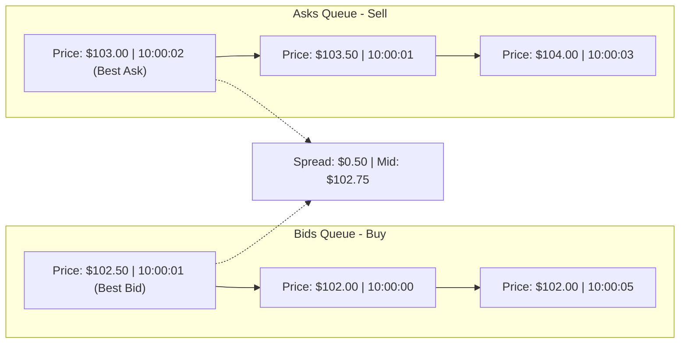

# TRADEGRID — Matching Engine Design Specification
## Limit Order Book, Price-Time Priority & Execution Logic

### 1. In-Memory Order Book Structure

Each tradable instrument maintains an isolated `OrderBook` instance. The order book consists of two queues:

1. **Bids Queue (Buy Orders)**:
   - **Primary Key (Price)**: Descending order (Highest bid price has highest priority).
   - **Secondary Key (Time)**: Ascending timestamp ($FIFO$ - earliest order at the same price has priority).
2. **Asks Queue (Sell Orders)**:
   - **Primary Key (Price)**: Ascending order (Lowest ask price has highest priority).
   - **Secondary Key (Time)**: Ascending timestamp ($FIFO$ - earliest order at the same price has priority).



---

### 2. Matching Algorithm

When an order arrives via `MatchingEngine.matchOrder(order)`:

1. **Validate tradability**: Verify instrument exists and market status is `ACTIVE`.
2. **Cross evaluation**:
   - If incoming order is **BUY**:
     - Candidate asks must satisfy:
       - Market Order: Any resting ask.
       - Limit Order: `ask.limitPrice <= incomingOrder.limitPrice`.
   - If incoming order is **SELL**:
     - Candidate bids must satisfy:
       - Market Order: Any resting bid.
       - Limit Order: `bid.limitPrice >= incomingOrder.limitPrice`.
3. **Execution Price Determination**:
   - **Rule**: Trades always execute at the limit price of the **resting passive order**.
   - If an incoming BUY limit at \$105 matches a resting SELL limit at \$100, the trade executes at **\$100.0000** (price improvement for the aggressive buyer).
4. **Volume Execution**:
   $$\text{Match Quantity} = \min(\text{incoming.remainingQuantity}, \text{resting.remainingQuantity})$$
5. **Partial Execution & State Transitions**:
   - If $\text{Match Quantity} == \text{resting.remainingQuantity}$, resting order is removed from the book and marked `FILLED`.
   - If $\text{Match Quantity} < \text{resting.remainingQuantity}$, resting order remains in the book with updated `remainingQuantity` and status `PARTIALLY_FILLED`.
   - Incoming order's remaining quantity is reduced.
   - If incoming order has remainder $> 0.0001$:
     - If `LIMIT`: Added to the appropriate side of the book as `OPEN` or `PARTIALLY_FILLED`.
     - If `MARKET`: Unmatched quantity is cancelled without resting on the book.
6. **Wash Trading Prevention**:
   - If `incoming.userId === resting.userId`, matching is disallowed to prevent manipulative self-trades.

---

### 3. Floating-Point Precision & Rounding Protections

In JavaScript, IEEE 754 floating-point arithmetic can introduce infinitesimal residuals:
$$12.0 - 5.0 - 7.0 = -1.776 \times 10^{-15}$$
To prevent matching loops:
1. All quantity and price math is rounded using fixed-point precision:
   ```ts
   parseFloat((currentRemaining - matchQuantity).toFixed(4))
   ```
2. Loop termination explicitly tests:
   ```ts
   while (currentRemaining > 0.0001 && counterpartyOrders.length > 0)
   ```
3. Database writes use `DECIMAL(18, 4)`.

---

### 4. Order Book Aggregation (Depth Levels)

For the `/api/v1/market/orderbook/:symbol` endpoint, the raw orders queue is aggregated by price:
- `price`: Fixed to 4 decimal places.
- `quantity`: Sum of `remainingQuantity` for all orders at that price level.
- `orderCount`: Count of resting orders at that price level.
- `total`: Cumulative depth running sum.
