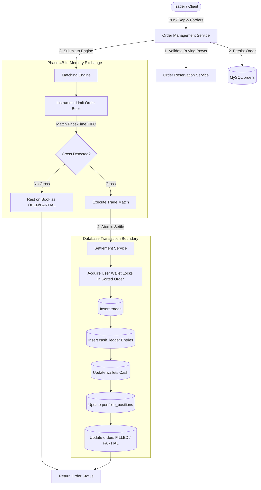

# TRADEGRID — Phase 4B Architecture Specification
## Continuous Matching Engine, Trade Execution & Atomic Settlement

### 1. Architectural Overview

Phase 4B transforms TRADEGRID from an order collection desk into a fully functioning, deterministic simulated exchange. It introduces:
1. **Continuous In-Memory Limit Order Book (LOB)**: Segregated books per instrument organizing resting bids and asks under strict price-time priority ($FIFO$).
2. **Matching Engine**: Deterministic continuous matching logic evaluating incoming aggressive orders against resting passive orders, supporting market orders, limit orders, partial fills, remaining quantity tracking, and wash-trade prevention.
3. **Execution Service**: Persistent recording of every atomic match into an immutable `trades` audit ledger table with execution prices, quantities, counterparty references, and fee records.
4. **Atomic Settlement Engine**: Real-time integration with the Phase 2 virtual wallet and double-entry ledger. Sells credit seller virtual cash; buys debit buyer virtual cash. Concurrently, share quantities and weighted-average cost basis are tracked in `portfolio_positions`.
5. **Concurrency & Deadlock Prevention**: Enforces pessimistic row-level locking (`FOR UPDATE`) on wallet rows ordered strictly by `MIN(buyerId, sellerId)` followed by `MAX(buyerId, sellerId)`.

---

### 2. Database Schema Extensions

#### 2.1 `trades` Table
Records executed transactions resulting from matches.
- `id`: BIGINT UNSIGNED AUTO_INCREMENT PRIMARY KEY
- `trade_reference`: VARCHAR(64) UNIQUE (Deterministic hash `TRD-{instrumentId}-{timestamp}-{random}`)
- `buy_order_id`: BIGINT UNSIGNED NOT NULL (FK -> `orders.id`)
- `sell_order_id`: BIGINT UNSIGNED NOT NULL (FK -> `orders.id`)
- `instrument_id`: BIGINT UNSIGNED NOT NULL (FK -> `instruments.id`)
- `buyer_id`: BIGINT UNSIGNED NOT NULL (FK -> `users.id`)
- `seller_id`: BIGINT UNSIGNED NOT NULL (FK -> `users.id`)
- `price`: DECIMAL(18, 4) NOT NULL (Execution price determined by resting passive order)
- `quantity`: DECIMAL(18, 4) NOT NULL (Executed volume)
- `trade_amount`: DECIMAL(18, 4) NOT NULL (`price * quantity`)
- `buyer_fee`: DECIMAL(18, 4) NOT NULL DEFAULT 0.0000
- `seller_fee`: DECIMAL(18, 4) NOT NULL DEFAULT 0.0000
- `status`: ENUM('SETTLED', 'FAILED') NOT NULL DEFAULT 'SETTLED'
- `settlement_transaction_id`: BIGINT UNSIGNED NULL (FK -> `cash_transactions.id`)
- `created_at`: TIMESTAMP DEFAULT CURRENT_TIMESTAMP

#### 2.2 `portfolio_positions` Table
Tracks user shareholdings, average cost basis, and realized profit/loss.
- `id`: BIGINT UNSIGNED AUTO_INCREMENT PRIMARY KEY
- `user_id`: BIGINT UNSIGNED NOT NULL (FK -> `users.id`)
- `instrument_id`: BIGINT UNSIGNED NOT NULL (FK -> `instruments.id`)
- `quantity`: DECIMAL(18, 4) NOT NULL DEFAULT 0.0000 (Shares currently held)
- `average_buy_price`: DECIMAL(18, 4) NOT NULL DEFAULT 0.0000 (Weighted average acquisition cost)
- `realized_pnl`: DECIMAL(18, 4) NOT NULL DEFAULT 0.0000 (Cumulative realized profit/loss)
- `created_at`: TIMESTAMP DEFAULT CURRENT_TIMESTAMP
- `updated_at`: TIMESTAMP DEFAULT CURRENT_TIMESTAMP ON UPDATE CURRENT_TIMESTAMP
- **Constraints**: UNIQUE KEY `idx_positions_user_instrument` (`user_id`, `instrument_id`)

---

### 3. Financial Integrity & Invariants

1. **Passive Price Improvement**: Trades execute at the limit price of the resting order that was already in the book. Aggressive market orders cross at the best resting passive price without slippage exceeding resting quotes.
2. **Double-Entry Balance Conservation**:
   $$\sum \text{Debits} \equiv \sum \text{Credits}$$
   For every trade settlement:
   - Buyer Cash: Credited to system trading escrow / debited from Buyer Wallet.
   - Seller Cash: Credited to Seller Wallet from system escrow.
   - System balance remains zero net delta.
3. **Pessimistic Row-Level Lock Ordering**:
   To prevent deadlocks when User A buys from User B while User B buys from User A simultaneously across instruments:
   $$\text{First Lock} = \min(u_1, u_2), \quad \text{Second Lock} = \max(u_1, u_2)$$
4. **Wash Trade Prevention**:
   An order whose `userId` matches the resting order's `userId` is rejected from crossing against itself.

---

### 4. API Endpoints

| Method | Path | Access | Description |
|---|---|---|---|
| `GET` | `/api/v1/market/orderbook/:symbol?depth=10` | Public | Returns aggregated bids and asks depth ladders, spread, and mid-price. |
| `GET` | `/api/v1/market/trades/:symbol?limit=50` | Public | Returns recent public trade executions tape for an instrument. |
| `GET` | `/api/v1/trades` | Authenticated | Returns paginated trade execution history for the calling user. |
| `GET` | `/api/v1/portfolio/summary` | Authenticated | Returns real-time user portfolio positions, cash balance, and unrealized/realized P&L. |
