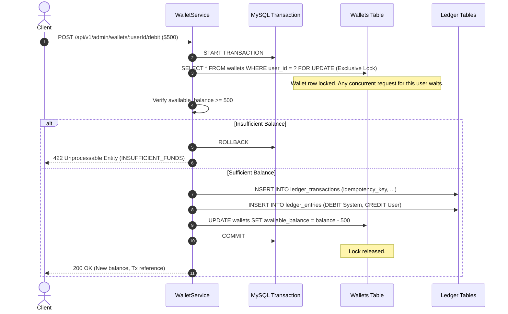

# TRADEGRID – Security & Financial Integrity Architecture

**Status:** Implemented (Phases 1 & 2).  
**Backend Framework:** Node.js, Express, TypeScript.  
**Password Hashing:** Argon2id (RFC 9106, memory-hard).  
**Authentication Standard:** Dual-token JWT (15-minute access token + 7-day cryptographically hashed refresh token with rotation).  
**Database Integrity:** MySQL 8 InnoDB, ACID transactions, Pessimistic Row Locks (`SELECT ... FOR UPDATE`), Idempotency Constraints.

---

## 1. Threat Model & Mitigations

In a virtual trading simulator, students and users may attempt malicious financial operations. The following mitigations are actively enforced:

| Threat | Attack Vector | Active Mitigation |
|--------|---------------|-------------------|
| **Client-Side Balance Tampering** | Editing Zustand/localStorage cash state | The server **never** trusts client-supplied balances. Balances are computed exclusively from database records. |
| **Race Conditions / Double Spending** | Sending concurrent debits/orders simultaneously | **Pessimistic row locking** (`SELECT ... FOR UPDATE`) acquires an exclusive lock on the wallet row during balance mutations. |
| **Network Retransmission Replays** | Double-clicking debit/credit or automated re-posts | **Unique idempotency keys** stored in `ledger_transactions.idempotency_key` reject duplicate executions. |
| **Unbalanced Money Creation** | Injecting cash without an audit trail | Strict **double-entry ledger invariance**: $\sum \text{Debits} == \sum \text{Credits}$. Every dollar credited to a user is counter-debited or balanced against an authorized system account. |
| **Privilege Escalation** | Traders invoking administrative wallet adjustments | Route-level middleware `authorizeRole('ADMIN')` inspects verified JWT claims before granting access to `/api/v1/admin/**`. |
| **Token Theft & Replay** | Stealing a long-lived access token | Access tokens expire in 15 minutes. Refresh tokens are stored hashed (SHA-256) and rotated on every `/refresh` call; old tokens are revoked immediately. |
| **SQL Injection** | Crafting malicious query inputs | Knex query builder uses parameterized SQL statements for 100% of queries. No string concatenation. |
| **XSS & Data Poisoning** | Injecting scripts via audit descriptions or usernames | Zod schema validation sanitizes and trims all inputs; React escapes rendered text by default. |

---

## 2. Financial Concurrency & Locking Architecture

### Pessimistic Locking Sequence (`SELECT ... FOR UPDATE`)
When balance-modifying operations occur (e.g. credit, debit, or future order reserve):



---

## 3. Idempotency Key Architecture

Idempotency ensures that API calls can be retried safely without unintended side-effects.

1. **Client Submission:** The client includes an `idempotencyKey` in the request body (or header).
2. **Key Inspection:** Inside the atomic database transaction, the `ledger_transactions` table is checked for an existing transaction with the same key.
3. **Replay Response:** If found, the existing transaction record and current wallet balance are returned immediately with zero balance mutation.
4. **Unique Constraint:** A database-level `UNIQUE (idempotency_key)` index provides an absolute safety net against race conditions.

---

## 4. Role-Based Access Control (RBAC)

Two core roles are defined:
- `TRADER`: Default role for all self-registered participants.
  - Can view own wallet (`GET /api/v1/wallet`).
  - Can view own transaction history (`GET /api/v1/wallet/transactions`).
  - Cannot access `/api/v1/admin/**`.
- `ADMIN`: Supervisory role.
  - Can execute virtual funds credits and debits (`POST /api/v1/admin/wallets/:userId/credit` and `debit`).
  - Can view all system accounts, halt exchange sessions, and inspect system audit trails.

Role enforcement middleware:
```typescript
export const authorizeRole = (...allowedRoles: Role[]) => {
  return (req: Request, res: Response, next: NextFunction) => {
    if (!req.user || !allowedRoles.includes(req.user.role)) {
      return next(new AppError(403, 'FORBIDDEN', 'Insufficient permissions for this resource'));
    }
    next();
  };
};
```

---

## 5. Audit Logging Standard

Every balance-changing event generates:
1. An immutable row in `ledger_transactions` with:
   - Unique reference string (e.g. `CRD-2-1718910000000-a1b2c3d4`)
   - Actor user ID (`created_by`)
   - Mandatory audit reason / memo (`description`)
   - High-resolution timestamp (`created_at`)
2. Structured console audit logs:
   ```json
   {
     "level": "INFO",
     "action": "ADMIN_CREDIT",
     "adminUserId": 1,
     "targetUserId": 2,
     "amount": "25000.0000",
     "oldBalance": "100000.0000",
     "newBalance": "125000.0000",
     "transactionReference": "CRD-2-1718910000000-a1b2c3d4"
   }
   ```
