# TRADEGRID — Trade Execution Flow Specification
## End-to-End Order Matching, Execution & Lifecycle

### 1. High-Level Sequence Diagram

The following sequence illustrates an incoming BUY order matching multiple resting SELL orders and atomically settling into the virtual ledger.

```mermaid
sequenceDiagram
    autonumber
    actor Buyer as Buyer (Trader 1)
    participant API as Express Router / OMS
    participant ME as Matching Engine
    participant Book as Instrument Order Book
    participant Settler as Settlement Service
    participant DB as MySQL Database

    Buyer->>API: POST /api/v1/orders (BUY 10 TGRID @ $100)
    API->>DB: Check Buying Power & Reserve Virtual Funds
    API->>DB: Insert Order (Status: PENDING)
    API->>ME: matchOrder(order)
    
    ME->>Book: Scan Asks Queue (FIFO Priority)
    Book-->>ME: Counterparty Found: Ask #1 (SELL 10 @ $100)
    
    ME->>Settler: settleTrade(buyOrder, sellOrder, price, qty)
    
    rect rgb(20, 30, 45)
        note over Settler, DB: Atomic Database Transaction Boundary
        Settler->>DB: Lock Buyer & Seller Wallets (Ordered User IDs)
        Settler->>DB: Insert into trades table
        Settler->>DB: Debit Buyer Cash ($1,000) & Credit System Escrow
        Settler->>DB: Credit Seller Cash ($1,000) & Debit System Escrow
        Settler->>DB: Update Buyer Position (+10 TGRID, recalculate avg cost)
        Settler->>DB: Update Seller Position (-10 TGRID, record realized PnL)
        Settler->>DB: Update Orders Status -> FILLED
    end

    Settler-->>ME: Trade Execution Settled
    ME->>Book: Remove Settled Ask #1 from Book
    ME-->>API: Match Result (1 Trade, 0 Remaining)
    API-->>Buyer: 201 Created (Order FILLED, Execution Details)
```

---

### 2. Multi-Counterparty Partial Fill Walkthrough

#### Initial State
- **Resting Ask 1**: Order #101, User #20, SELL 5.0000 @ \$100.0000 (Submitted at 10:00:00)
- **Resting Ask 2**: Order #102, User #30, SELL 7.0000 @ \$101.0000 (Submitted at 10:00:05)
- **Incoming Order**: Order #201, User #10, BUY 15.0000 LIMIT @ \$102.0000

#### Step 1: Matching against Ask 1
- **Eligible**: Limit \$102.0000 $\ge$ Ask \$100.0000.
- **Match Qty**: $\min(15.0, 5.0) = 5.0000$.
- **Execution Price**: \$100.0000 (Resting order price).
- **Settlement 1**:
  - Trade: 5 shares @ \$100.0000 = \$500.0000.
  - Buyer #10 debited \$500; Seller #20 credited \$500.
  - Order #101 marked `FILLED` and removed from book.
  - Incoming Order #201 remaining quantity becomes $15.0 - 5.0 = 10.0000$.

#### Step 2: Matching against Ask 2
- **Eligible**: Limit \$102.0000 $\ge$ Ask \$101.0000.
- **Match Qty**: $\min(10.0, 7.0) = 7.0000$.
- **Execution Price**: \$101.0000 (Resting order price).
- **Settlement 2**:
  - Trade: 7 shares @ \$101.0000 = \$707.0000.
  - Buyer #10 debited \$707; Seller #30 credited \$707.
  - Order #102 marked `FILLED` and removed from book.
  - Incoming Order #201 remaining quantity becomes $10.0 - 7.0 = 3.0000$.

#### Step 3: Book Placement for Remaining Shares
- No further resting asks $\le$ \$102.0000 exist.
- Incoming Order #201 remaining quantity is $3.0000 > 0.0001$.
- Order #201 status is updated to `PARTIALLY_FILLED`.
- Remaining 3.0000 shares @ \$102.0000 are inserted into the Bids queue as the new Best Bid.

---

### 3. Error Handling and Atomic Rollbacks

- If any step during settlement fails (e.g. database connection timeout, constraint violation), the entire database transaction rolls back.
- Wallet row locks are guaranteed to be released via `finally` blocks.
- The resting orders retain their original in-memory quantities, maintaining strict consistency between database state and order book state.
